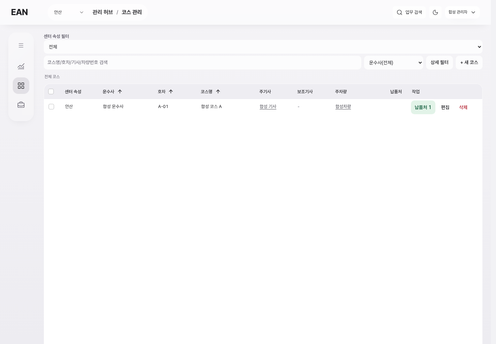
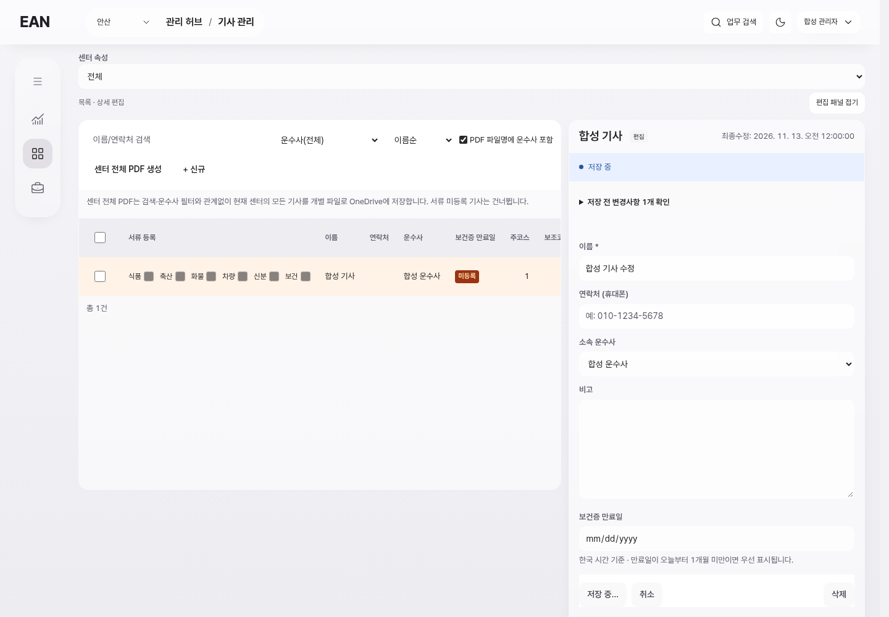
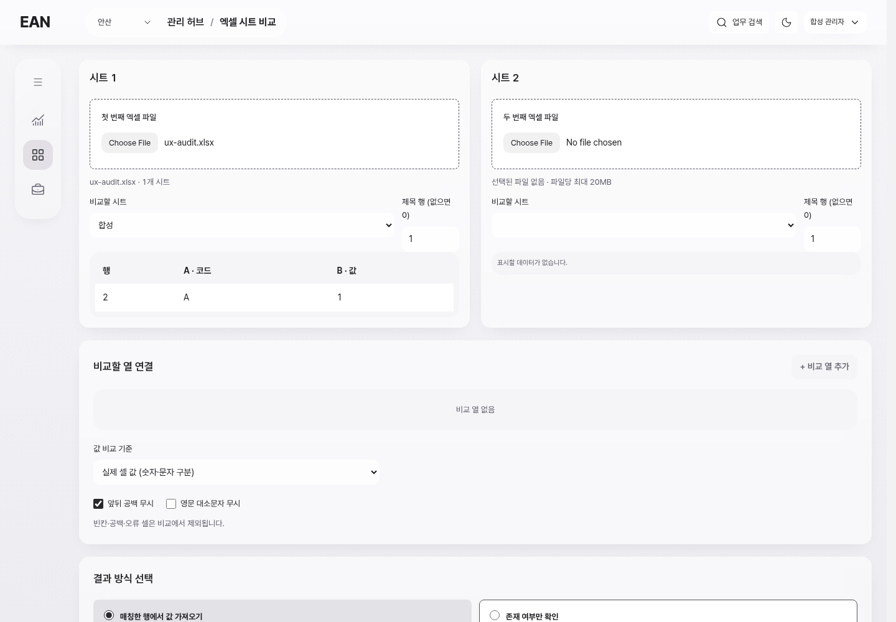
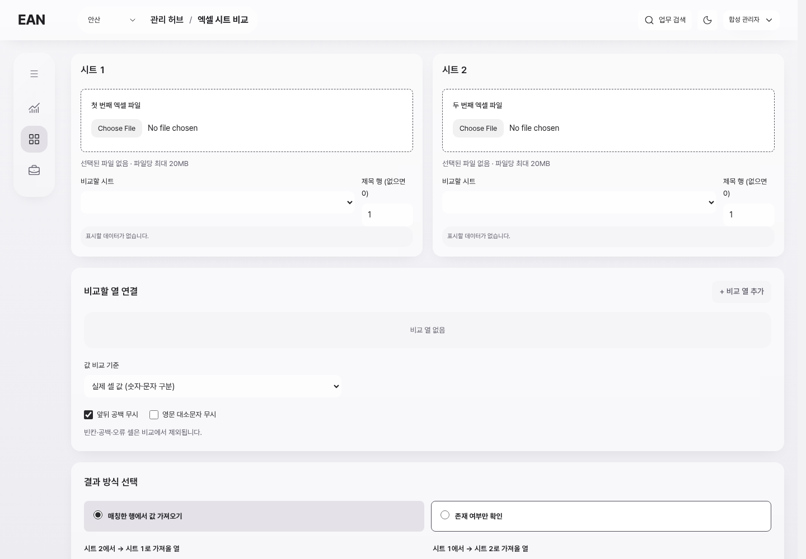
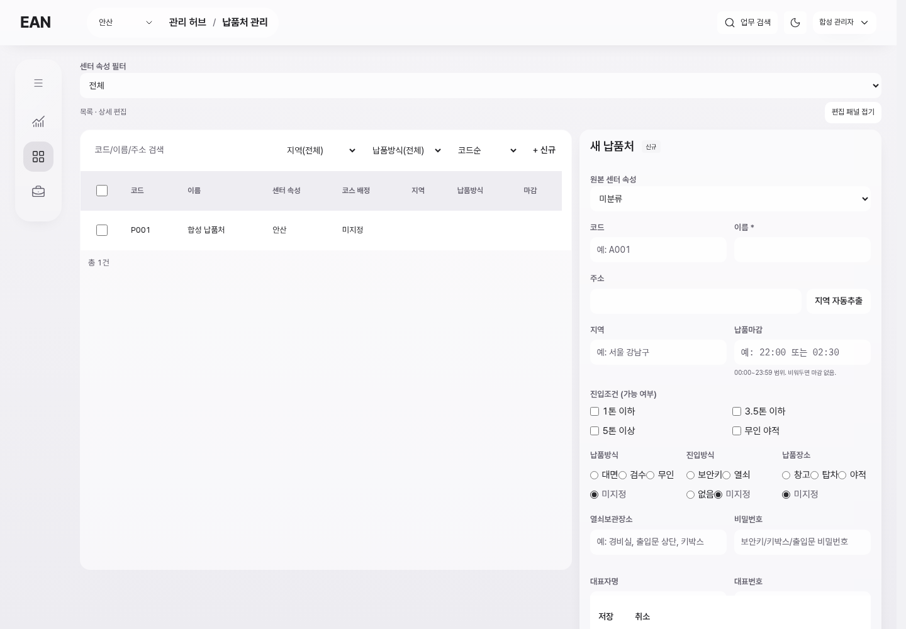
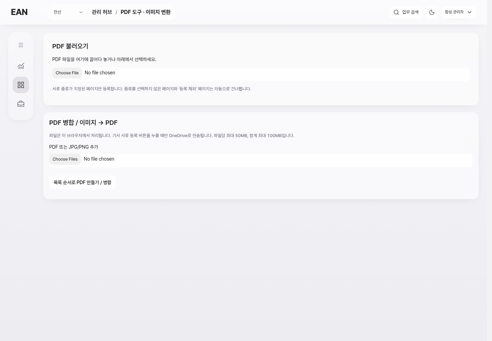
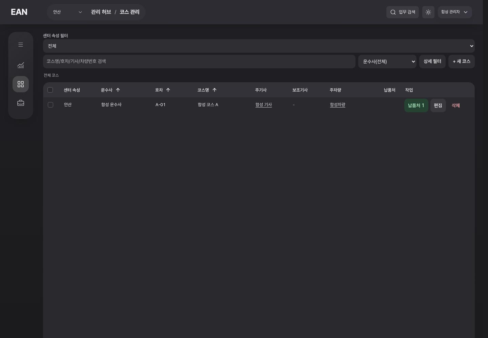

# 기존 웹 UI·UX 점검 — 사용 중단과 작업 피로

기준: 2026-11-13, `SAJOANSAN` main `d16aca5024401227e54fb25a6c5d33ae91b9178a`.
요청: 페이지마다 권한 인증과 저장 로딩처럼 보이는 상태를 포함해 웹 전반의 문제를 조사하고 단계별 수정 구상 제시. **제품 코드 수정·운영 데이터 쓰기·배포는 이번 작업에 포함하지 않았다.**

## 조사 범위와 증거 수준
- `app/src/page-paths.ts`의 **40개 주소 / 35개 페이지 모듈**을 기능군으로 목록화했다. 페이지별 진입·상태 처리 위치를 확인하고 공통 인증·이동·셸·편집·파일·상세 경로와 대표 화면을 심층 점검했다. 모든 함수와 모든 업무 상태를 전수 실행했다는 뜻은 아니다.
- 이번 조사에서 내부 Linux Chromium 1440×1000으로 실제 현재 UI 코드를 렌더링했다. 8개 대표 화면(코스, 기사, 납품처, 대시보드, 허브, Excel 비교, PDF 도구, 이배송)과 페이지 이동·저장·복귀 상태를 캡처했다.
- 데이터·권한·OneDrive는 **합성 대역**, 인증 지연은 단계별 800ms, 저장 지연은 약 2초로 주입했다. 실제 서버 지연 시간이나 실제 직원 권한/DB 저장 성능으로 보고하지 않는다. 대역은 별도 브라우저 요청에서만 적용했고 제품 파일은 수정하지 않았다.
- 기록의 **B**는 이번 브라우저 재현, **S**는 현재 소스에서 확인한 동작/구조, **P**는 이를 바탕으로 한 개선 제안이다. 실행하지 않은 경로는 통과가 아니라 미확인이다.
- 초기 캡처의 타이밍 불일치와 대역 export 누락은 폐기했다. 저장 화면의 날짜는 유효한 합성 ISO 값으로 다시 캡처했다. 테마 전환 도중 낮아 보인 대비는 안정 후 정상임을 확인해 결함에서 제외했다.
- 실제 로그인 세션을 사용하지 않았으며 사용자 PC, 운영 데이터, 외부 AI/지도/파일 저장에는 접근/쓰기하지 않았다. 운영 사용자별·Windows·최대 자료량·전체 접근성 적합성은 미확인이다.

## 우선 결론
인증 확인 자체보다 **매 이동 때 강제 재조회**, **화면 전체 조작 차단**, **일부 경로의 완전 새로고침**, **화면별 입력 보존 차이**가 사용을 끊는다. 먼저 공통 동작을 고치고, 그 다음 상세/폼/도구/시각 정리를 진행한다. 권한 검사를 없애거나 저장 성공을 먼저 표시하는 방식은 사용하지 않는다.

이미 있는 기반은 재사용한다: WorkspaceFrame, 공통 세션/권한 조회, 기존 저장·충돌 처리, Radix 모달/포커스, 목록 상태 보존, 연결 원본 패널, 파일 영역. 새 ERP·새 디자인 시스템·새 전역 작업 엔진은 필요하지 않다.

## 발견 사항 18개
우선순위 P0는 먼저 해결할 사용 중단/입력 유실, P1은 반복 업무 부담, P2는 배치/일관성 개선이다. 보안 위험 등급을 의미하지 않는다.

| ID | 우선·근거 | 실제 문제와 발생 조건 | 최소 수정안·그대로 두면 생기는 부담 |
|---|---|---|---|
| U01 | P0 B/S | 코스→납품처 내부 이동에서도 `main.tsx:91`이 `loadAuthContext(true)`를 호출한다. `auth.ts:23`의 30초 캐시가 무효화되고 getUser→프로필→권한을 다시 기다린다. 합성 실행에서 auth/권한 호출 각각 1→2회. | 유효한 컨텍스트 재사용, 필요한 시점의 재검증·동시 요청 합치기. 로그아웃/비활성/권한 변경은 계속 반영. 안 고치면 페이지 수만큼 불필요한 대기 반복. |
| U02 | P0 B/S | `workspace-navigation.ts:6`의 연속 이동은 10개 페이지만 지원한다. 기사·코스별 납품처·파일 도구 등은 제외되어 문서가 다시 로드된다. 납품처→기사에서 셸 없이 인증 화면 재현. | 제외 이유(파일 수명·문서 스타일·정리 이벤트)를 화면별로 해결한 뒤 순차 편입. 단순 목록 추가로 처리하지 않는다. 안 고치면 화면 간 체감과 상태 보존이 계속 다름. |
| U03 | P0 B/S | `main.tsx:24–31`이 이동 중 body 자식 전체를 inert로 만든다. 표와 메뉴는 보이지만 선택/복사/탐색이 막힌다. 합성 캡처에서 inert 자식 5개. | 현재 내용과 셸 유지, 이동 요청만 중복 방지·최신 요청 선택. 미저장/저장 중 이탈 가드는 별도 유지. 안 고치면 멈춘 화면처럼 느껴짐. |
| U04 | P0 B/S | `EditorStatus.tsx:19`의 busy가 셸 전체 disabled로 전달된다. 기사 이름 한 칸 저장 중 메뉴·검색·테마·계정 버튼 모두 disabled 확인. Dashboard는 편집기를 여는 것만으로 잠금(`Dashboard.tsx:301`), Portal도 공통 busy를 셸에 전달(`Portal.tsx:715`). | 저장 대상/충돌 가능한 작업만 잠그고 무관한 조작은 허용. 서버 저장이 끝나기 전 페이지 폐기 허용은 별도 검증 후. 안 고치면 작은 저장도 전체 로딩처럼 느껴짐. |
| U05 | P1 B/S | 기사 저장 때 상단 상태 띠·버튼 문구·폼 비활성·셸 잠금이 겹친다. 완료는 토스트, 실패는 폼별 안내로 흩어진다. 저장/불러오기/외부 처리의 표시 기준도 서로 다름. | 변경 없음/미저장/저장 중/저장됨/실패/충돌/결과 확인 필요를 구분. 저장 버튼 옆 짧은 상태, 실패만 지속 안내. 실제 성공 전 성공 표시 금지. |
| U06 | P0 B/S | Excel 비교에서 파일을 읽고 허브로 이동 후 뒤로 가면 파일/시트가 초기화된다. `ExcelCompare.tsx:16` 이후 state만 사용하며 이탈 가드가 없다. 합성 xlsx의 파일 표시→복귀 후 files=0 재현. | 조건·파일명·지문·작업 위치 보존과 이탈 안내부터. File 바이트는 살아 있는 탭 메모리 범위/재선택을 명시. 다른 도구도 같은 기준으로 적용 여부 기록. 안 고치면 파일 준비를 반복. |
| U07 | P1 S | 기사·차량·운수사 검색/선택은 지역 state에서 시작하며 코스·납품처의 보존 계약과 다르다. Workbench 패널 접힘도 마운트 때 false로 초기화된다. | 기존 사용자/탭별 문맥 저장 방식으로 검색·선택·스크롤·패널 상태 범위 통일. 모든 입력을 서버 초안으로 확대하지 않는다. 안 고치면 같은 업무를 찾는 과정 반복. |
| U08 | P1 S | 연결 상세는 iframe이므로 새 JS 인증 컨텍스트로 진입한다. 닫을 때 `LinkedRecordDetail.tsx:55`가 전체 부모 재조회를 완료해야 닫힌다. 연결별로는 부모→코스 상세→원본의 중첩도 존재하며, Radix 기본 modal과 overlay로 배경 작업을 막는다. | 일상 조회의 모달 잠금 필요성을 줄이고, 재인증/닫기 대기/갱신 실패 피드백을 명확히 하며 안전한 요청 재사용 범위 검토. 토큰 복사·권한 우회 금지. 필요성이 확인된 부분만 기존 편집기 컴포넌트 직접 연결 검토. |
| U09 | P1 S/B | 대시보드 원본 값은 우측 상세, 시간은 셀 편집, 보건증은 복사, 행 여백은 기존 중앙 상세로 동작한다. 코스 목록의 코스는 별도 편집 모달이다. 원본 이름 클릭 누락은 직전 수정했지만 전체 조작 원칙은 아직 혼재. | 이름=원본 상세, 값 편집=명시적 편집/F2, 연결 교체=별도 동작이라는 공통 규칙. 복사 버튼/표시와 키보드 안내는 짧게. 기존 빠른 편집과 안정 ID 유지. |
| U10 | P1 S | 네트워크 오류 시 `Users.tsx:21`은 목록을 [], `AuditLog.tsx:54`는 행/건수를 0으로 만든다. 빈 목록 문구는 실패와 분리되어 있어 원래 자료가 없는 것처럼 보일 수 있다. 공통 인증/이동 실패도 새로고침 안내가 중심이다. | 마지막 성공 목록 보존+현재 갱신 실패 표시+그 요청만 재시도. 최초 빈 상태/검색 결과 없음/권한 없음/실패 구분. 안 고치면 자료 소실 오해와 불필요한 새로고침. |
| U11 | P1 S | 필수값 검증/서버 오류는 폼에 따라 토스트, 상단 오류, 브라우저 기본 검증이 섞인다. `RouteForm.tsx:58`의 이름 누락은 토스트만으로 알려준다. 접근 불가(`AdminPage.tsx:436`)는 전체 모달→다른 영역 이동 방식. | 오류 필드 옆 메시지·첫 오류 포커스·입력 보존·재시도 제공. 접근 불가는 현재 위치/돌아갈 곳을 보여주되 권한 정책은 변경하지 않는다. |
| U12 | P1 S/P | 대시보드 검색 확정, 코스/납품처 debounce, 감사 이력 조회 버튼, 기능 검색, 업무/문서 검색은 범위·시점이 서로 다르다. 동일하게 보이는 검색 입력만으로 결과 범위를 이해하기 어렵다. | 가벼운 현재 목록은 즉시/짧은 debounce, 서버/문서 검색은 명시적 실행을 유지하되 범위·필터·결과 수 표시 통일. 전부 키 입력마다 외부 조회로 바꾸지 않는다. |
| U13 | P2 B/S | 기사/납품처 진입 즉시 빈 신규 폼이 열려 480px를 차지한다. 목록 확인 전 새 등록을 해야 하는 화면처럼 보이고, 납품처 폼의 조건 라디오/주소 필드는 좁아진다. | 선택 전에는 목록 중심, 선택/신규 때 기존 우측 패널. 사용자 폭/접힘 유지. 원본 필드는 삭제·합치지 않고 관련 필드 묶음/명확한 label 간격 조정. |
| U14 | P1 B/S | PDF 입구에 PDF 불러오기·서류 등록 안내와 PDF/이미지 병합이 함께 나온다. Excel은 두 파일을 넣기 전에도 빈 비교 열·값 기준·결과 방식이 넓게 노출되어 실행 버튼이 아래로 밀린다. | 입력→확인·설정→실행→결과를 점진적으로 펼친다. PDF 편집/병합/기사 서류 등록의 현재 작업을 명확히 분리하되 기존 기능·양식·계산은 유지. |
| U15 | P1 B/S | 이배송은 행 추가와 DB 저장이 별개인데 초기 화면에 DB 새로고침/선택 삭제/전체 초기화/DB 저장이 비슷한 비중이다. OneTopWork는 네이티브 confirm, PalletSlips는 alert를 사용한다. | 입력·목록 반영·서버 저장의 상태를 명시하고 위험 작업을 분리. 공통 확인 대화상자에 대상/영향/보존 범위를 표시. 삭제 기능 제거 또는 임의 자동 저장은 하지 않는다. |
| U16 | P1 S/P | 파일 도구마다 원본 선택·브라우저 생성·서버 저장·외부 전송·다운로드 준비의 상태와 재개 표현이 다르다. 거리/평택 등의 busy는 셸 잠금으로 전달되고 외부 실패도 작업 전체 대기로 보일 수 있다. | 실제 완료 단계/실패 항목/기존 결과를 같은 방식으로 표시하고 실패 부분만 재시도. 브라우저 종료 후 실행 지속/파일 보존을 거짓으로 약속하지 않는다. |
| U17 | P2 B/S/P | 좁은 상세의 라디오 간격, 중복 제목/설명, 작은 상태 글씨와 네이티브 파일 선택이 페이지마다 다르다. 일부 표 행은 클릭과 별도 편집 버튼의 의미를 함께 가진다. | 기존 테마 유지, 필드·버튼·표 밀도와 초점/키보드/상태 읽기 정리. 영문 네이티브 파일 버튼은 브라우저 locale 영향이므로 번역 결함으로 단정하지 않음. 다크 안정 후 주요 링크 대비는 정상 확인; 전체 WCAG 통과는 미검증. |
| U18 | P1 S | 사용자 폐기 결정과 달리 기능 카탈로그에 보건증 Notion 메뉴가 남고, NotionHealth는 ‘일시 중지’ 및 외부 링크를 제공한다. | 현재 탐색/직접 진입을 폐기 상태로 명확히 정리. 과거 데이터·보고서 보존, 재연결 구현 금지. OneDrive/OneNote와 구분. 안 고치면 재개 예정 기능으로 오해. |

## 화면별 적용표 — 누락 방지
B=이번 대표 화면 재현/캡처, S=소스 검토. S는 실제 업무 입력/저장/외부 호출을 수행했다는 뜻이 아니다. 각 단계 구현 시 이 표에 해당 화면의 결과를 추가하고, 미확인은 남겨둔다.

| 페이지 모듈 | 현재 확인 | 중점 문제 / 후속 검증 |
|---|---|---|
| Dashboard | B/S | 인증·셀/상세 구분·편집만으로 셸 잠금·열/검색/복귀 |
| AdminHub | B/S | 공통 이동·기능 탐색·중복 제목·폐기 메뉴 |
| Portal | S | 단일 busy의 메뉴/목록 영향·뷰 변경·파일/업무 저장 구분 |
| Routes | B/S | 강제 인증·전체 inert·원본/연결/편집·목록 보존 |
| RouteEdit | S | 네이티브 이동 예외·중첩 상세·저장 후 복귀 |
| DeliveryPoints | B/S | 신규 폼 기본 펼침·공통/연결 조건·좁은 필드·복귀 |
| Drivers | B/S | 전체 재로딩·저장 셸 잠금·서류/연결 설정 혼재·목록 문맥 |
| Vehicles | S | 검색/선택 보존·저장 잠금·후보/연결 의미 |
| Companies | S | 검색/선택 보존·저장 잠금·원본/서류 구분 |
| Users | S | 로딩/실패/빈 목록 구분·접근 불가·계정 입력 오류 |
| Settings | S | 소유자 전용 설정·브라우저 저장과 서버 설정의 표시 구분 |
| AuditLog | S | 조회 실패 시 목록 지움·필터 확정/복귀·빈 상태 |
| Login | S | 최초 인증/재인증/세션 만료 구분; 실제 계정 로그인 미실시 |
| CourseImport | S | 파일/매핑/검증/실제 저장 단계와 부분 실패 안내 |
| CourseExport | S | 출력 조건/열 순서/원본 범위·다운로드 상태 보존 |
| PyeongtaekDispatch | S | 기존 미저장 가드 재사용·CJ/수동/도로 보기별 처리 중 의미 |
| CharterParser | S | 전체 셸 busy·분석 수정/DB 저장/월 보관/부분 재개 구분 |
| GimhaeDispatch | S | 요청/회신/수정/결과·센터 이탈 가드·실패 후 입력 유지 |
| DispatchParser | S | 원문/파싱 결과/복사 단계·원문 이탈 보존 확인 |
| HaulCalculator | S | 개별 계산기 진입/실행/결과·전용 문서 생명주기 |
| KakaoRoutes | S | 합성 메시지 파싱/행 선택/복사·미저장 입력 복귀 |
| Transfers | B/S | 행 추가 vs DB 저장·초기화/삭제·사진·입력 복귀 |
| DistanceCalculator | S | 전체 셸 잠금·주소/계산/부분 실패/출력 |
| NaverDistance | S | 전체 셸 잠금·조회/캡처/일치 검증·실패와 재시도 |
| PdfTools | B/S | 입력 전 설정 과다·변환과 기사 서류 등록 구분·파일 수명 |
| ExcelCompare | B/S | 파일 소실 재현·선택/설정/비교/출력 순서·저장 범위 |
| ImageStraightener | S | 사진 수명·키보드·원본/보정 결과·이탈 안내 |
| PalletSlips | S | 원본/매칭/출력·alert·선택 파일/조건 보존 |
| DailyTemperature | S | 템플릿/입력/생성 파일 상태·클립보드·미저장 값 |
| OneTopWork | S | 기기 사진/DB 임시저장/분석/결과·네이티브 confirm |
| CoupangEntry | S | 템플릿/분석/출력/업무 연결 상태·기존 성공 보존 |
| Operations | S | 업무 유형/상세/처리/보고 상태·현재값과 이력 |
| MailDailyBriefing | S | 날짜/현재 업무/보관 보고 구분·재조회·입력 상태 |
| Talkcloud | S | 외부 iframe busy 전달·계정 연결 실패·재개; 실제 외부 미확인 |
| NotionHealth | S | 사용자 폐기, 탐색 및 직접 주소의 잔존 안내 정리 대상 |

## 이번 캡처와 관찰
아래 모두 이번 실행에서 새로 캡처한 합성 화면이다. 로딩 화면은 정상 완료 화면으로 사용한 것이 아니라, 이번 요청의 **반복 인증 증상 자체**를 기록한 것이다.

| 순서 | 상태 | 판정 |
|---|---|---|
| 1 | 납품처→기사 진입 | 전체 문서 교체·권한 확인 화면 노출, 개선 필요 |
| 2 | 코스→납품처 내부 이동 | 내용은 남지만 전체 inert, 개선 필요 |
| 3 | 기사 한 필드 저장 | 관계없는 셸 버튼까지 disabled, 개선 필요 |
| 4 | Excel 원본 등록 | 실제 합성 파일/시트/행 표시 정상 |
| 5 | 허브로 이동 후 Excel 복귀 | 원본 파일/선택 초기화, 개선 필요 |
| 6 | 납품처 초기 화면 | 빈 신규 상세가 기본으로 목록 폭 차지, 정리 제안 |
| 7 | PDF 초기 화면 | 변환/병합/서류 등록 진입이 혼재, 정리 제안 |
| 8 | 코스 다크 안정 상태 | 주요 링크 색 확인 정상, 테마 전면 교체 근거 없음 |

### 1. 반복 인증

### 2. 내부 이동 중 잠금

이미지만으로 inert를 증명하지 않는다. 같은 실행 DOM 측정의 body 자식 inert=5, 인증 호출 1→2회와 함께 해석한다.

### 3. 저장 중 셸 잠금

DOM으로 메뉴·센터·검색·테마·계정의 disabled=true를 확인했다.

### 4–5. 파일 등록과 복귀 후 소실

### 6–8. 배치와 테마

다크 링크 computed color `rgb(222,222,229)`, 바로 아래 불투명 배경 `rgb(41,41,46)` 확인. 전환 중 캡처로 대비 결함을 주장하지 않았다.

## 조사 실행 기록
- `node /tmp/web-ux-audit/browser.cjs`: 대표 8개 화면/조작 캡처. 최종 대역 수정 후 pageerror 0.
- `node /tmp/web-ux-audit/boundaries.cjs`: 강제 인증 1→2, 내부 이동 inert=5, 기사 재인증, Excel 파일 준비→복귀 files=0, 다크 확인. pageerror 0.
- `node /tmp/web-ux-audit/final-captures.cjs`: 유효 날짜의 저장 잠금, 전환 종료 후 다크 상태 재캡처. pageerror 0.
- 경로 인벤토리 생성, 관련 상태/이동/오류/폼 소스 읽기. 새로운 테스트 인프라나 제품 테스트 파일은 추가하지 않았다.
- UI/UX 스킬 지침은 기존 DESIGN.md에 맞춰 대조했다. Product Design 저장 컨텍스트는 없음. 외부 참고의 공통 override 리소스는 읽기 도구에서 제공되지 않아 해당 내용을 추정하지 않았다.
- [8단계 실행 구상](../plans/WEB-UX-IMPROVEMENT-PLAN.md)으로 이어진다. 구현은 **0/8**이며 이번 결과는 조사/계획 완료다.
